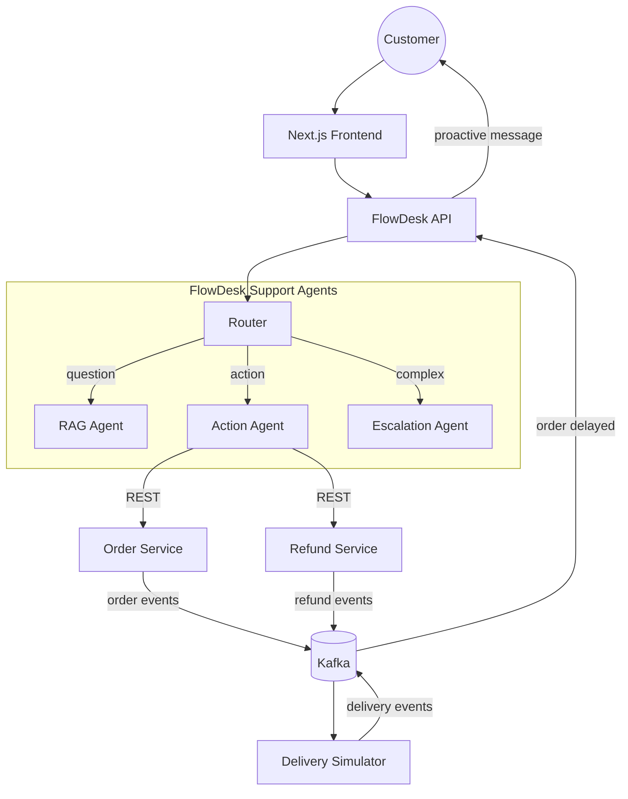

# FlowDesk: AI Customer Support for a Food-Delivery Platform

A support system for a delivery app, run by a small team of AI agents. It answers questions from help documents, takes real actions like cancelling orders and issuing refunds (under safety rules), and messages customers on its own when a delivery is delayed.

> **Credit:** This project is built on the open-source [FlowDesk](https://github.com/tonystalker/FlowDesk) by tonystalker. The original provides the multi-agent support core (router, hybrid RAG, escalation). See "What I added" below for my work on top of it.

---

## What it does

- **Answers questions** like "What is your refund policy?" by searching the help documents and writing a grounded answer.
- **Takes actions** like checking an order, cancelling it, or issuing a refund by calling real order and refund APIs.
- **Stays safe.** Refunds are limited by guardrails. Large or risky cases go to a human.
- **Reaches out first.** If a delivery is delayed, the system messages the customer with an update without being asked.

## How it works (simple version)

| Part | What it does |
|---|---|
| **Customer chat (Next.js)** | Where the customer types their question |
| **FlowDesk API** | Receives the message and passes it to the AI team |
| **Router agent** | Reads the message and decides who handles it |
| **RAG agent** | Looks up help documents and writes the answer |
| **Action agent** | Calls the order and refund services, with safety rules |
| **Escalation agent** | Hands the case to a human when needed |
| **Order service** | Tracks every order and its stage |
| **Refund service** | Handles money-back requests |
| **Kafka** | A shared notice board where services post events like "order shipped" |
| **Delivery simulator** | Pretends to be riders and sometimes creates delays for testing |
| **PostgreSQL** | Stores orders, refunds, and a log of every conversation |

## Architecture



## Example flows

1. **Policy question:** "What's your refund policy?" The router sends it to the RAG agent, which finds the policy and answers.
2. **Action request:** "Cancel my order and refund me." The router sends it to the action agent. The guardrails check the amount, and then it calls the order and refund services. A large refund goes to a human instead.
3. **Proactive update:** The delivery simulator reports a delay on Kafka. FlowDesk sees it and messages the customer with the new time and any compensation the policy allows.

## What I added

On top of the original FlowDesk, I added:

- Order service and refund service, each with its own state machine and database
- Kafka event flow between the services
- Delivery simulator that produces shipped, delayed and delivered events
- Action agent connected to the real order and refund APIs, with refund guardrails
- Proactive delay notifications driven by Kafka events

## Key features

- **Hybrid search:** combines meaning-based search with keyword search, then re-ranks the results for better accuracy.
- **Smart model routing:** quick, simple queries go to a fast model (Groq Llama 3.3), and harder or retried ones go to Gemini.
- **Confidence checks:** if the answer looks unreliable, the agent retries with a wider search and a stronger model.
- **Logging and feedback:** every interaction is stored, along with confidence scores and thumbs up/down feedback.
- **Fallbacks:** if the embedding service is down, search falls back to keyword-only so the system keeps working.

## Tech stack

- **Agents:** LangGraph
- **Models:** Groq (Llama 3.3 70B), Google Gemini
- **Search:** Pinecone, BM25, Sentence Transformers cross-encoder
- **Backend:** FastAPI, PostgreSQL, Kafka
- **Frontend:** Next.js, Tailwind CSS
- **CI/CD:** GitHub Actions, Google Cloud Run, Vercel

## Getting started

**Requirements:** Python 3.11+, [uv](https://docs.astral.sh/uv/), Node.js 18+

```bash
# 1. Clone and install
git clone https://github.com/<your-username>/<your-repo>.git
cd <your-repo>
uv sync
cd flowdesk-demo && npm install && cd ..

# 2. Configure
cp .env.example .env
# Add: GEMINI_API_KEY, GROQ_API_KEY, PINECONE_API_KEY, PINECONE_ENV, DATABASE_URL
echo "BACKEND_URL=http://127.0.0.1:8000" > flowdesk-demo/.env.local

# 3. Set up the database and load the help documents
uv run alembic upgrade head
uv run python -m retrieval.ingest

# 4. Start Kafka, the order and refund services, and the delivery simulator
# <add your start command here, e.g. docker compose up>

# 5. Start the backend and the frontend
uv run uvicorn gateway.main:app --reload
cd flowdesk-demo && npm run dev
```

The app runs at http://localhost:3000 and the API at http://localhost:8000.

## Testing

```bash
uv run pytest -v                          # run the tests
uv run ruff check .                       # check code style
uv run python -m evaluation.eval_harness  # measure search quality
```

## Project structure

```text
├── gateway/        # FastAPI backend
├── orchestrator/   # LangGraph agents (router, RAG, action, escalation)
├── retrieval/      # Hybrid search: ingest, dense + keyword, re-ranking
├── evaluation/     # Quality measurement
├── db/             # Database models and migrations
├── docs/           # Help documents the agents search
├── tests/          # Test suite
├── flowdesk-demo/  # Next.js frontend
└── .github/        # CI/CD pipeline
```

## Deployment

Every push to `main` runs the linter and tests, builds the Docker image, and deploys to Google Cloud Run through GitHub Actions.

Required GitHub secrets: `GCP_SA_KEY`, `PROJECT_ID`, `GEMINI_API_KEY`, `GROQ_API_KEY`, `PINECONE_API_KEY`, `PINECONE_ENV`, `DATABASE_URL`.

## Credits

Core support agent: [tonystalker/FlowDesk](https://github.com/tonystalker/FlowDesk).
